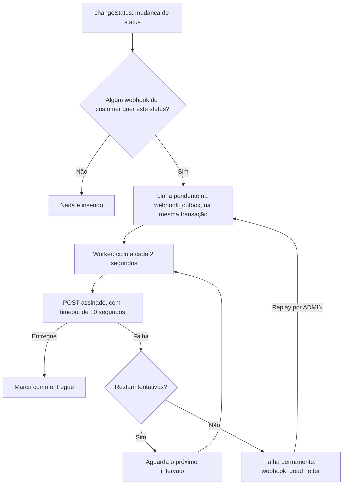

# FDD: Sistema de Webhooks de Notificação de Pedidos

Versão: 1.4
Data: 2026-11-02
Responsável: Diego Soares, autor deste pacote de documentos (não é o Diego participante da reunião)

**Como ler este documento**

- **Sem marcador:** acordado na reunião ou existente no código, com a origem indicada.
- **`[Derivado]`:** a reunião não detalhou o item, mas ele decorre do código ou de uma decisão fechada, ou é exigido no FDD pelo enunciado. Nenhum comportamento novo é proposto.
- **`[Decisão do autor]`:** escolha do autor do pacote para um ponto que a reunião não fechou, pendente de confirmação dos revisores. Não é decisão da reunião.
- **`[Não definido]`:** a reunião não fechou o ponto, e este documento não sugere resposta. Os pontos estão reunidos na seção 14.

---

## 1. Contexto e motivação técnica

- **FDD-CTX-01:** clientes B2B consultam `GET /orders` periodicamente para detectar mudanças de status, e querem ser notificados ([09:00] Marcos).
- **FDD-CTX-02:** `changeStatus` é uma transação pesada, e um HTTP dentro dela faria um cliente lento travar outras mudanças de status ([09:04] Bruno).
- **FDD-CTX-03:** a conferência em `src/modules/orders/order.service.ts` mostrou que a transação sempre atualiza o pedido e grava o histórico. O estoque só muda em PENDING para PAID (débito) e em PAID ou PROCESSING para CANCELLED (reposição), conforme `src/modules/orders/order.status.ts`.
- **FDD-CTX-04:** os atores são o usuário autenticado que representa o cliente ([09:32] Marcos), o ADMIN que faz replay ([09:36] Sofia) e o endpoint externo do cliente ([09:19] Sofia).

As decisões de arquitetura estão nos [ADRs](adrs/README.md). Este documento detalha como construí-las.

---

## 2. Objetivos técnicos

| ID | Objetivo | Medida ou invariante | Origem |
| --- | --- | --- | --- |
| **FDD-OBJ-01** | Notificar dentro do limite aceito pelos clientes | Em operação normal, a primeira tentativa começa em menos de 10 segundos após o commit | [09:02] Marcos |
| **FDD-OBJ-02** | Manter status e evento consistentes | Se a transação confirmou, o evento foi registrado; se reverteu, o evento some junto | [09:06] Diego |
| **FDD-OBJ-03** | Entregar ao menos uma vez | O mesmo evento pode chegar mais de uma vez, sempre com o mesmo `event_id` | [09:24] Diego |
| **FDD-OBJ-04** | Aplicar a política de retry decidida | Intervalos de 1m, 5m, 30m, 2h e 12h, somando 14h36 | [09:17] Larissa |
| **FDD-OBJ-05** | Permitir que o cliente valide origem e integridade | Toda entrega leva HMAC-SHA256 do corpo do request | [09:22] Sofia |
| **FDD-OBJ-06** | Reaproveitar a stack | Nenhuma biblioteca nova de log ou erro | [09:30] Larissa |

---

## 3. Escopo e exclusões

**Incluído**

- **FDD-ESC-01:** publicação transacional do evento em `changeStatus` ([09:40] Bruno).
- **FDD-ESC-02:** worker separado, com polling, retry e DLQ ([09:48] Larissa).
- **FDD-ESC-03:** CRUD de configuração de webhook ([09:33] Bruno).
- **FDD-ESC-04:** rotação de secret com 24 horas de validade paralela ([09:21] Sofia).
- **FDD-ESC-05:** histórico de entregas ([09:34] Marcos).
- **FDD-ESC-06:** replay manual da DLQ por ADMIN ([09:35] Diego).

**Excluído**

- **FDD-EXC-01:** webhooks de entrada; a feature é só de saída ([09:02] Marcos).
- **FDD-EXC-02:** e-mail de aviso ao cliente; fica para uma possível próxima fase ([09:37] Larissa).
- **FDD-EXC-03:** dashboard visual; é projeto separado do time de frontend ([09:40] Larissa).
- **FDD-EXC-04:** rate limiting de saída; decisão adiada para depois de observar ([09:39] Larissa).
- **FDD-EXC-05:** arquivamento de linhas entregues ([09:08] Diego).
- **FDD-EXC-06:** múltiplos workers ([09:13] Diego).
- **FDD-EXC-07:** evento na criação do pedido. A reunião tratou da integração em `changeStatus` ([09:40] Bruno), e `OrderService.create` grava o status inicial por outro caminho (`src/modules/orders/order.service.ts`).
- **FDD-EXC-08:** endpoint de listagem da DLQ, que não foi discutido. O replay recebe o `id` da entrada ([09:18] Bruno, [09:18] Diego), e como obtê-lo está em FDD-ND-11.

---

## 4. Modelo de dados

**FDD-DADOS-01:** `prisma/schema.prisma` recebe as tabelas abaixo e uma migration. Nomes de tabela seguem o padrão `@@map`, e nomes de coluna ficam em camelCase, como em `prisma/migrations/20260519182739_init/migration.sql`. Por isso, `created_at` da reunião ([09:08] Diego) corresponde à coluna `createdAt`.

### Outbox

**FDD-DADOS-02:** tabela `webhook_outbox`, com uma linha por evento, inserida na mesma transação da mudança de status ([09:06] Diego).

| Coluna | Conteúdo | Origem |
| --- | --- | --- |
| `id` | UUID | [09:51] Larissa |
| `eventId` | UUID gerado quando o evento entra na outbox, único por evento | [09:25] Diego |
| `orderId` | Id do pedido | [09:43] Diego |
| `payload` | Payload renderizado na inserção | [09:52] Larissa |
| `status` | Pendente, processando, falhou ou entregue, com índice | [09:08] Diego |
| `createdAt` | Momento da inserção, com índice | [09:08] Diego |
| `attempts` | `[Derivado]` Reenvios já agendados, necessário para respeitar o teto | [09:17] Larissa |
| `nextAttemptAt` | `[Derivado]` Momento da próxima tentativa, necessário para aplicar o backoff | [09:17] Larissa |

- **FDD-DADOS-03:** ids em UUID, seguindo o padrão do projeto ([09:51] Larissa). No código, os ids são `@db.Char(36)` com `uuid()` (`prisma/schema.prisma`).
- **FDD-DADOS-04:** o payload é um snapshot: se o pedido mudar depois, o evento continua refletindo o estado de quando o status mudou ([09:52] Larissa).

### Configuração de webhook

**FDD-DADOS-05:** a reunião definiu que a tabela guarda URL, secret, `customer_id` e estado ativo ([09:21] Bruno), além da lista de status de interesse ([09:31] Marcos).

**FDD-DADOS-07:** `[Derivado]` nome de trabalho `webhook_endpoints`. A reunião falou em "tabela de configuração de webhook", sem nome ([09:21] Bruno), e usou o termo "endpoint webhook" ([09:44] Sofia).

| Coluna | Conteúdo | Origem |
| --- | --- | --- |
| `id` | UUID, enviado em `X-Webhook-Id` | [09:44] Sofia |
| `customerId` | Customer dono do cadastro | [09:21] Bruno |
| `url` | URL `https` | [09:23] Sofia |
| `secret` | Secret única do endpoint | [09:21] Sofia |
| `statuses` | Lista de status que o webhook quer ouvir | [09:33] Marcos |
| `active` | Estado ativo | [09:21] Bruno |
| `previousSecret` e `previousSecretExpiresAt` | `[Derivado]` Necessários para a secret antiga valer por mais 24 horas | [09:21] Sofia |

**FDD-AUT-02:** `[Decisão do autor]` a secret fica em texto na tabela, como descrito na reunião ([09:21] Bruno), e o ponto vai para a revisão de segurança ([09:46] Sofia).

### Histórico de entregas

**FDD-DADOS-08:** `[Derivado]` tabela de trabalho `webhook_deliveries`, necessária para o cliente consultar sucesso ou falha, payload, resposta e tempo de resposta ([09:34] Marcos). Colunas: `id`, `webhookId`, `eventId`, `success`, `responseStatus`, `responseBody`, `durationMs` e `attemptedAt`. O payload vem do evento correspondente.

### DLQ

**FDD-DADOS-06:** tabela `webhook_dead_letter`, separada da outbox, com payload, motivo da falha e timestamp ([09:18] Diego). `[Derivado]` Colunas: `id`, `eventId`, `payload`, `reason` e `failedAt`. O `eventId` é necessário para recolocar o evento na outbox no replay.

**FDD-DADOS-09:** o projeto já usa o tipo de chave e os índices citados (`prisma/schema.prisma`). As relações entre as novas tabelas dependem de FDD-ND-01, FDD-ND-13 e FDD-ND-15.

---

## 5. Fluxos detalhados



### 5.1 Criação do evento na outbox

**FDD-FLUXO-01:** dentro da transação de `changeStatus`, depois de gravar o histórico, `publishWebhookEvent(tx, order, from, to)` executa os passos abaixo ([09:41] Bruno).

1. Consulta, com o `tx`, os webhooks do `order.customerId` (`[Derivado]`, necessário para o filtro).
2. Verifica se algum quer o status de destino ([09:33] Marcos).
3. Se nenhum quiser, retorna sem inserir ([09:34] Bruno).
4. Gera o `event_id` UUID e renderiza o payload ([09:25] Diego, [09:52] Larissa).
5. Insere a linha pendente na outbox ([09:06] Diego).

**Fluxos alternativos**

- **FDD-FLUXO-02:** se a inserção falhar, a transação inteira sofre rollback, e o status não muda ([09:40] Bruno).
- **FDD-FLUXO-03:** validações anteriores da transação, como transição inválida ou estoque insuficiente, encerram o fluxo antes da publicação, sem evento (`src/modules/orders/order.service.ts`).

### 5.2 Processamento pelo worker

**FDD-FLUXO-04:** o processo `src/worker.ts` roda em loop de polling: a cada 2 segundos, busca os eventos pendentes mais antigos, em batch pequeno, processa e marca ([09:09] Diego, [09:08] Diego). O processamento segue a ordem de `created_at` ([09:12] Diego).

**FDD-FLUXO-09, FDD-AUT-01:** `[Decisão do autor]` enquanto um evento aguarda nova tentativa, os eventos seguintes do mesmo pedido não são enviados. Isso preserva a ordem por pedido registrada na reunião ([09:13] Larissa), que não tratou do caso de retry.

**FDD-FLUXO-05:** para cada evento:

1. Marca a linha como processando ([09:08] Diego).
2. Monta o corpo a partir do snapshot e verifica o limite de 64KB; acima disso, não envia e gera erro ([09:23] Sofia, [09:24] Larissa).
3. Assina o corpo e envia o `POST`, com timeout de 10 segundos ([09:22] Sofia, [09:42] Diego).
4. `[Derivado]` Grava o resultado para o histórico de entregas ([09:34] Marcos).
5. Marca como entregue quando a entrega tiver sucesso ([09:08] Diego).
6. Em caso de falha, segue para 5.3.

### 5.3 Retry

**FDD-FLUXO-12:** a falha na entrega segue a tabela abaixo ([09:17] Larissa). Resposta que não chega em 10 segundos conta como falha ([09:42] Diego).

A contagem usa a leitura registrada em [ADR-004](adrs/ADR-004-retry-com-backoff-e-dlq.md): as "5 tentativas" da reunião são 5 reenvios depois do envio inicial, a única leitura compatível com "quase 15 horas entre primeira falha e última tentativa" ([09:17] Diego). `[Derivado]` A contagem usa o limite `WEBHOOK_MAX_RETRIES = 5` e os cinco intervalos.

| Falha em | `attempts` depois da falha | Próxima tentativa | Tempo acumulado desde a primeira falha |
| --- | --- | --- | --- |
| Envio inicial | 1 | 1 minuto | 1 minuto |
| Reenvio 1 | 2 | 5 minutos | 6 minutos |
| Reenvio 2 | 3 | 30 minutos | 36 minutos |
| Reenvio 3 | 4 | 2 horas | 2h36 |
| Reenvio 4 | 5 | 12 horas | 14h36 |
| Reenvio 5 | 5 | Nenhuma: falha permanente | Não se aplica |

O tempo gasto nas chamadas HTTP não entra na soma da tabela.

**FDD-FLUXO-13:** o reenvio mantém o corpo, por causa do snapshot, e o `X-Event-Id` ([09:52] Larissa, [09:25] Diego). O `X-Timestamp` traz o momento de cada envio ([09:44] Diego).

### 5.4 DLQ e replay

**FDD-FLUXO-14:** esgotadas as tentativas, a falha é considerada permanente, e o evento vai para a DLQ ([09:15] Diego), que guarda payload, motivo da falha e timestamp ([09:18] Diego).

**FDD-FLUXO-15:** o replay é manual e recoloca o evento na outbox como pendente ([09:18] Diego). `[Derivado]` O evento continua sendo o mesmo, então mantém o `event_id`, único por evento ([09:25] Diego). Quem executou fica registrado em log ([09:36] Sofia).

---

## 6. Contratos públicos

**FDD-CONTRATO-01, prefixo das rotas:** a reunião citou as rotas sem prefixo, mas `src/app.ts` monta toda a API em `/api/v1`. Portanto, `GET /webhooks/:id/deliveries` ([09:34] Marcos) é exposta como `GET /api/v1/webhooks/:id/deliveries`.

**Autenticação:** as rotas de configuração aceitam qualquer role autenticada ([09:37] Sofia), com JWT Bearer. O customer não vem do JWT ([09:32] Larissa).

**`[Derivado]` Padrões vindos do código:**

- Status de sucesso: `201` na criação, `200` em consulta, edição e ação, `204` na remoção (`src/modules/customers/customer.controller.ts`, `src/modules/orders/order.controller.ts`).
- Erros: `{ "error": { "code", "message", "details" } }` (`src/middlewares/error.middleware.ts`).
- Listagens: `{ "data", "pagination" }`, com padrão de 20 e máximo de 100 itens por página (`src/shared/http/response.ts`, `src/modules/customers/customer.schemas.ts`).
- Campos da API em camelCase, como `customerId` (`src/modules/orders/order.schemas.ts`). O payload entregue ao cliente usa os nomes em snake_case definidos na reunião ([09:43] Diego).

### FDD-CONTRATO-02: Criar webhook

- **Tipo:** endpoint HTTP
- **Rota:** `POST /api/v1/webhooks` ([09:31] Marcos)
- **Semântica:** recebe URL e lista de status, e a secret é gerada pela plataforma e devolvida na criação ([09:31] Marcos). O `customerId` vai no body (ver FDD-ND-16) ([09:32] Larissa).
- **Status:** `201` criado; `400` `VALIDATION_ERROR`, inclusive para URL que não seja `https` (ver FDD-ERRO-13); `401` `UNAUTHORIZED`; `404` `WEBHOOK_CUSTOMER_NOT_FOUND`.

**Exemplo de requisição**

```json
{
  "customerId": "a1d4e8b2-5c3f-47a9-9e06-7b2c1f8d3e54",
  "url": "https://cliente.example.com/webhooks/pedidos",
  "statuses": ["SHIPPED", "DELIVERED"]
}
```

**Exemplo de resposta (`201`)**

```json
{
  "id": "5e8d2a44-1b6c-4f3e-a7d9-0c3f6b8e2d11",
  "customerId": "a1d4e8b2-5c3f-47a9-9e06-7b2c1f8d3e54",
  "url": "https://cliente.example.com/webhooks/pedidos",
  "statuses": ["SHIPPED", "DELIVERED"],
  "active": true,
  "secret": "whsec_exemplo_nao_usar_em_producao",
  "createdAt": "2026-11-02T12:00:00.000Z",
  "updatedAt": "2026-11-02T12:00:00.000Z"
}
```

### FDD-CONTRATO-03: Listar webhooks de um customer

- **Tipo:** endpoint HTTP
- **Rota:** `GET /api/v1/customers/:customerId/webhooks` ([09:33] Bruno)
- **Semântica:** o `customerId` vai no path, uma das duas opções citadas (ver FDD-ND-16) ([09:32] Larissa). A reunião só previu a devolução da secret na criação ([09:31] Marcos), por isso ela não aparece aqui.
- **Status:** `200` sucesso; `400` `VALIDATION_ERROR`; `401` `UNAUTHORIZED`; `404` `WEBHOOK_CUSTOMER_NOT_FOUND`.

**Exemplo de requisição**

```http
GET /api/v1/customers/a1d4e8b2-5c3f-47a9-9e06-7b2c1f8d3e54/webhooks?page=1&pageSize=20
Authorization: Bearer <token>
```

**Exemplo de resposta (`200`)**

```json
{
  "data": [
    {
      "id": "5e8d2a44-1b6c-4f3e-a7d9-0c3f6b8e2d11",
      "customerId": "a1d4e8b2-5c3f-47a9-9e06-7b2c1f8d3e54",
      "url": "https://cliente.example.com/webhooks/pedidos",
      "statuses": ["SHIPPED", "DELIVERED"],
      "active": true,
      "createdAt": "2026-11-02T12:00:00.000Z",
      "updatedAt": "2026-11-02T12:00:00.000Z"
    }
  ],
  "pagination": { "page": 1, "pageSize": 20, "total": 1, "totalPages": 1 }
}
```

### FDD-CONTRATO-04: Editar webhook

- **Tipo:** endpoint HTTP
- **Rota:** `PATCH /api/v1/webhooks/:id` ([09:33] Bruno)
- **Semântica:** `[Derivado]` aceita os campos da criação como opcionais, como `updateCustomerSchema` em `src/modules/customers/customer.schemas.ts`. Como o filtro é aplicado na inserção ([09:34] Bruno), a alteração de `statuses` vale para as próximas mudanças de status.
- **Status:** `200` atualizado; `400` `VALIDATION_ERROR`; `401` `UNAUTHORIZED`; `404` `WEBHOOK_NOT_FOUND`.

**Exemplo de requisição**

```json
{ "statuses": ["PAID", "SHIPPED", "DELIVERED"] }
```

**Exemplo de resposta (`200`)**

```json
{
  "id": "5e8d2a44-1b6c-4f3e-a7d9-0c3f6b8e2d11",
  "customerId": "a1d4e8b2-5c3f-47a9-9e06-7b2c1f8d3e54",
  "url": "https://cliente.example.com/webhooks/pedidos",
  "statuses": ["PAID", "SHIPPED", "DELIVERED"],
  "active": true,
  "createdAt": "2026-11-02T12:00:00.000Z",
  "updatedAt": "2026-11-02T12:30:00.000Z"
}
```

### FDD-CONTRATO-05: Remover webhook

- **Tipo:** endpoint HTTP
- **Rota:** `DELETE /api/v1/webhooks/:id` ([09:33] Bruno)
- **Semântica:** remove o cadastro. O efeito sobre eventos e histórico está em FDD-ND-13.
- **Status:** `204` removido, sem corpo; `401` `UNAUTHORIZED`; `404` `WEBHOOK_NOT_FOUND`.

**Exemplo de requisição**

```http
DELETE /api/v1/webhooks/5e8d2a44-1b6c-4f3e-a7d9-0c3f6b8e2d11
Authorization: Bearer <token>
```

**Exemplo de resposta (`204`):** sem corpo.

**Exemplo de resposta (`404`)**

```json
{ "error": { "code": "WEBHOOK_NOT_FOUND", "message": "Webhook not found" } }
```

### FDD-CONTRATO-06: Rotacionar secret

- **Tipo:** endpoint HTTP
- **Rota:** a reunião definiu o endpoint, não a rota ([09:21] Sofia); ver FDD-ND-04.
- **Semântica:** o cliente pede uma nova secret pela API, e a antiga fica válida por 24 horas em paralelo ([09:21] Sofia).
- **Status:** `200` rotacionada; `401` `UNAUTHORIZED`; `404` `WEBHOOK_NOT_FOUND`.

**Exemplo de requisição:** autenticada, sem corpo, para o webhook desejado.

**Exemplo de resposta (`200`)**

```json
{
  "id": "5e8d2a44-1b6c-4f3e-a7d9-0c3f6b8e2d11",
  "secret": "whsec_nova_exemplo_nao_usar"
}
```

### FDD-CONTRATO-07: Consultar histórico de entregas

- **Tipo:** endpoint HTTP
- **Rota:** `GET /api/v1/webhooks/:id/deliveries` ([09:34] Marcos)
- **Semântica:** devolve as entregas com sucesso ou falha, payload, resposta e tempo de resposta ([09:34] Marcos). "Últimos 100" foi citado como exemplo. `[Derivado]` A paginação existente comporta esse número, com máximo de 100 itens por página.
- **Status:** `200` sucesso; `400` `VALIDATION_ERROR`; `401` `UNAUTHORIZED`; `404` `WEBHOOK_NOT_FOUND`.

**Exemplo de requisição**

```http
GET /api/v1/webhooks/5e8d2a44-1b6c-4f3e-a7d9-0c3f6b8e2d11/deliveries?page=1&pageSize=100
Authorization: Bearer <token>
```

**Exemplo de resposta (`200`), para uma falha por timeout**

```json
{
  "data": [
    {
      "id": "c2f7a915-3d48-4b06-8e1a-6f9d2b7c4e30",
      "eventId": "7f3b2c1e-9a4d-4e8b-b6f1-2d5c8a7e0f13",
      "success": false,
      "responseStatus": null,
      "responseBody": null,
      "durationMs": 10000,
      "payload": { "event_id": "7f3b2c1e-9a4d-4e8b-b6f1-2d5c8a7e0f13", "event_type": "order.status_changed" },
      "attemptedAt": "2026-11-02T12:00:13.120Z"
    }
  ],
  "pagination": { "page": 1, "pageSize": 100, "total": 1, "totalPages": 1 }
}
```

O `payload` do exemplo está abreviado; a resposta traz o snapshot completo.

### FDD-CONTRATO-08: Replay da DLQ

- **Tipo:** endpoint HTTP administrativo
- **Rota:** `POST /api/v1/admin/webhooks/dead-letter/:id/replay` ([09:35] Diego)
- **Semântica:** exige role ADMIN com `requireRole` ([09:36] Larissa), recoloca o evento na outbox como pendente ([09:18] Diego) e grava em log quem executou ([09:36] Sofia).
- **Status:** `200` recolocado; `401` `UNAUTHORIZED`; `403` `FORBIDDEN`; `404` `WEBHOOK_DEAD_LETTER_NOT_FOUND`.

**Exemplo de requisição**

```http
POST /api/v1/admin/webhooks/dead-letter/9b1e4c72-8a35-4d60-b2f7-3e6a1d9c5f08/replay
Authorization: Bearer <token de um ADMIN>
```

**Exemplo de resposta (`200`)**

```json
{
  "deadLetterId": "9b1e4c72-8a35-4d60-b2f7-3e6a1d9c5f08",
  "eventId": "7f3b2c1e-9a4d-4e8b-b6f1-2d5c8a7e0f13",
  "status": "PENDING"
}
```

### FDD-CONTRATO-09: Entrega ao cliente

- **Tipo:** requisição HTTP de saída
- **Rota:** `POST` na URL `https` cadastrada ([09:23] Sofia)
- **Status:** falta de resposta em 10 segundos conta como falha ([09:42] Diego). As demais respostas estão em FDD-ND-06.

| Header | Conteúdo | Origem |
| --- | --- | --- |
| `Content-Type` | `application/json` | [09:44] Diego |
| `X-Event-Id` | UUID do evento, único por evento | [09:25] Diego |
| `X-Signature` | HMAC-SHA256 sobre o corpo do request | [09:44] Diego |
| `X-Timestamp` | Momento do envio, para o cliente detectar replay attack se quiser | [09:44] Diego |
| `X-Webhook-Id` | Id do endpoint webhook que originou o envio | [09:44] Sofia |

**Exemplo de corpo**, com os campos definidos na reunião ([09:43] Diego):

```json
{"event_id":"7f3b2c1e-9a4d-4e8b-b6f1-2d5c8a7e0f13","event_type":"order.status_changed","timestamp":"2026-11-02T12:00:00.000Z","order_id":"3c9a1f52-6b7e-4d10-8f2a-1e4b7c9d0a66","order_number":"ORD-000123","from_status":"PROCESSING","to_status":"SHIPPED","customer_id":"a1d4e8b2-5c3f-47a9-9e06-7b2c1f8d3e54","total_cents":17000}
```

Os items não são enviados, e o cliente consulta `GET /orders/:id` se precisar de detalhes ([09:43] Diego).

### FDD-CONTRATO-12: Função interna de publicação

- **Tipo:** função
- **Assinatura:** `publishWebhookEvent(tx, order, fromStatus, toStatus)`, que recebe o client da transação atual ([09:41] Bruno)
- **Semântica:** não há injeção de repository ([09:41] Diego). Se lançar erro, a transação de `changeStatus` é revertida ([09:40] Bruno).

---

## 7. Matriz de erros previstos

Erros do módulo usam o prefixo `WEBHOOK_` ([09:29] Larissa). A reunião citou `WEBHOOK_NOT_FOUND`, `WEBHOOK_INVALID_URL` e `WEBHOOK_SECRET_REQUIRED` como exemplos ([09:28] Bruno). Os demais nomes são `[Derivado]`: aplicam o prefixo às condições indicadas.

| ID | Código | HTTP | Condição | Tratamento | Origem da condição |
| --- | --- | --- | --- | --- | --- |
| **FDD-ERRO-01** | `WEBHOOK_NOT_FOUND` | 404 | Webhook inexistente | Recusa a operação | [09:28] Bruno |
| **FDD-ERRO-02** | `WEBHOOK_INVALID_URL` | Ver FDD-ERRO-13 | URL que não seja `https` | Recusa com erro de validação | [09:23] Sofia |
| **FDD-ERRO-03** | `WEBHOOK_PAYLOAD_TOO_LARGE` | Não se aplica | Evento acima de 64KB | Não envia e gera erro | [09:24] Larissa |
| **FDD-ERRO-04** | `WEBHOOK_DELIVERY_TIMEOUT` | Não se aplica | Cliente não responde em 10 segundos | Trata como falha e marca para retry | [09:42] Diego |
| **FDD-ERRO-05** | `WEBHOOK_DELIVERY_FAILED` | Não se aplica | Cliente offline | Aplica o retry | [09:14] Larissa |
| **FDD-ERRO-08** | `WEBHOOK_CUSTOMER_NOT_FOUND` | 404 | `customerId` inexistente, como já faz `OrderService.create` | Recusa a operação | `src/modules/orders/order.service.ts` |
| **FDD-ERRO-09** | `WEBHOOK_DEAD_LETTER_NOT_FOUND` | 404 | Entrada da DLQ inexistente no replay | Recusa o replay | [09:35] Diego |
| **FDD-ERRO-11** | `WEBHOOK_PUBLISH_FAILED` | 500 | Falha ao inserir na outbox | Rollback da transação | [09:40] Bruno |

**Regras de implementação vindas do código**

- **FDD-ERRO-12:** `NotFoundError` fixa o código `NOT_FOUND`, por isso os erros 404 acima precisam de classes derivadas diretamente de `AppError`. `BadRequestError`, `ConflictError` e `UnprocessableEntityError` aceitam código customizado (`src/shared/errors/http-errors.ts`).
- **FDD-ERRO-13:** a regra de `https` é uma validação no schema Zod ([09:23] Sofia), e `validate` converte toda falha de schema em `VALIDATION_ERROR` (`src/middlewares/validate.middleware.ts`). Com o middleware atual, URL `http` responde `400` `VALIDATION_ERROR`. Como `WEBHOOK_INVALID_URL` seria emitido é FDD-ND-17.
- **FDD-ERRO-14:** falhas genéricas de formato (`VALIDATION_ERROR`), autenticação (`UNAUTHORIZED`) e permissão (`FORBIDDEN`) continuam vindo de `src/middlewares/validate.middleware.ts` e `src/middlewares/auth.middleware.ts`.
- **FDD-ERRO-15:** o ramo de `AppError` em `src/middlewares/error.middleware.ts` não grava log. `WEBHOOK_PUBLISH_FAILED` só aparece nos logs se for registrado com o `logger` antes de ser lançado.
- **FDD-ERRO-16:** `WEBHOOK_SECRET_REQUIRED` foi citado como exemplo ([09:28] Bruno), mas não entra na matriz, porque a secret é gerada pela plataforma e não há fluxo em que ela falte ([09:31] Marcos).

---

## 8. Estratégias de resiliência

| ID | Estratégia | Definição | Origem |
| --- | --- | --- | --- |
| **FDD-RES-01** | Timeout | 10 segundos por chamada HTTP | [09:42] Diego |
| **FDD-RES-02** | Retries | Teto de tentativas, para o evento não ficar pendurado; contagem em 5.3 | [09:15] Diego |
| **FDD-RES-03** | Backoff | 1m, 5m, 30m, 2h, 12h | [09:17] Larissa |
| **FDD-RES-04** | Fallback | DLQ persistida em tabela separada e replay manual; e-mail como fallback fica para a próxima fase | [09:48] Larissa |
| **FDD-RES-05** | Isolamento | A falha do cliente não afeta a transação de status, porque o HTTP fica no worker | [09:04] Bruno |
| **FDD-RES-06** | Sobrevivência a reinícios | Worker em processo separado da API | [09:11] Diego |
| **FDD-RES-07** | Duplicatas | Admitidas pela garantia at-least-once e tratadas pelo cliente com `X-Event-Id` | [09:26] Larissa |

**Invariantes**

- **FDD-RES-08:** não pode haver caso de status mudar e evento não sair ([09:40] Bruno).
- **FDD-RES-09:** nenhuma chamada HTTP ao cliente acontece dentro da transação de status ([09:04] Bruno).
- **FDD-RES-10:** o evento reflete o estado de quando o status mudou, inclusive nos reenvios ([09:52] Larissa).

---

## 9. Observabilidade

A reunião definiu o uso do Pino e o log de auditoria do replay ([09:29] Bruno, [09:36] Sofia), e rate limiting ficou para observar ([09:39] Diego). O enunciado exige que o FDD trate de métricas, logs e tracing. Como o projeto não tem biblioteca de métricas nem de tracing (`package.json`) e a decisão foi de reuso máximo ([09:30] Larissa), os itens abaixo são `[Derivado]`: usam só dados já definidos, sem ferramenta nova.

### Logs

**FDD-OBS-01:** logs estruturados pelo `logger` de `src/shared/logger/index.ts`, com eventos em snake_case, como em `src/server.ts`.

| Evento | Campos |
| --- | --- |
| `webhook_worker_started` | Sem campos adicionais |
| `webhook_event_enqueued` | `eventId`, `orderId`, `toStatus` |
| `webhook_delivery_attempted` | `eventId`, `webhookId`, `orderId`, `success`, `responseStatus`, `durationMs` |
| `webhook_event_dead_lettered` | `eventId`, `reason` |
| `webhook_dead_letter_replayed` | `deadLetterId`, `eventId`, `userId` |

**FDD-OBS-02:** `webhook_dead_letter_replayed` guarda quem executou o replay, para auditoria ([09:36] Sofia).

**FDD-OBS-03:** a lista `redactPaths` de `src/shared/logger/index.ts` não cobre campos de secret. O tratamento está em FDD-ND-18.

### Métricas

**FDD-OBS-04:** indicadores obtidos das tabelas e dos logs, sem nova dependência:

| Métrica | Como obter | Para que serve |
| --- | --- | --- |
| `webhook_first_attempt_latency_seconds` | Primeira tentativa menos `createdAt` da outbox | Verificar o limite de 10 segundos ([09:02] Marcos) |
| `webhook_outbox_pending_total` | Contagem de linhas pendentes | Acompanhar o acúmulo de eventos ([09:07] Bruno) |
| `webhook_delivery_total{success}` | Contagem no histórico de entregas | Sucesso e falha ([09:34] Marcos) |
| `webhook_dead_letter_total` | Contagem em `webhook_dead_letter` | Falhas permanentes ([09:18] Diego) |
| `webhook_deliveries_per_minute{customer}` | Agregação no histórico de entregas | Observar a necessidade de rate limiting ([09:39] Diego) |

### Tracing

**FDD-OBS-05:** correlação por campos de log, sem tracing distribuído. O `eventId` liga publicação, tentativas, DLQ e replay, e o mesmo valor chega ao cliente em `X-Event-Id` ([09:25] Diego).

**FDD-OBS-06:** a requisição de `changeStatus` já tem `requestId` em `src/middlewares/request-logger.middleware.ts`, que continua servindo para rastrear a chamada à API.

---

## 10. Integração com o sistema existente

**Novos arquivos (a criar)**

- **Módulo:** `src/modules/webhooks`, com controller, service, repository, routes e schemas, como os demais ([09:27] Bruno).
- **Entrada do worker:** `src/worker.ts`, com o script `npm run worker` ([09:11] Larissa).
- **Lógica do worker:** arquivo no módulo, citado como `src/modules/webhooks/webhook.worker.ts` ou `src/modules/webhooks/webhook.processor.ts` ([09:28] Bruno).

**Arquivos existentes**

| ID | Arquivo | Integração | Origem |
| --- | --- | --- | --- |
| **FDD-INT-01** | `src/modules/orders/order.service.ts` | `changeStatus` chama `publishWebhookEvent` dentro da mesma transação, depois de `tx.orderStatusHistory.create`. O construtor de `OrderService` não muda | [09:40] Bruno |
| **FDD-INT-02** | `src/modules/orders/order.status.ts` | Sem alteração. Define as transições cujos status de destino alimentam o filtro | [09:33] Marcos |
| **FDD-INT-03** | `src/shared/errors/http-errors.ts` | Recebe as classes de erro do módulo, junto de `InsufficientStockError` e `InvalidStatusTransitionError` | [09:28] Bruno |
| **FDD-INT-04** | `src/shared/errors/index.ts` | Exporta as novas classes | [09:28] Bruno |
| **FDD-INT-05** | `src/middlewares/error.middleware.ts` | Sem alteração. Trata os novos erros pelo ramo de `AppError` | [09:29] Bruno |
| **FDD-INT-06** | `src/middlewares/auth.middleware.ts` | `authenticate` nas rotas de configuração; `requireRole('ADMIN')` no replay | [09:36] Larissa |
| **FDD-INT-07** | `src/middlewares/validate.middleware.ts` | Sem alteração. Valida os schemas do módulo | [09:30] Larissa |
| **FDD-INT-08** | `src/shared/logger/index.ts` | Reuso do logger no módulo e no worker | [09:29] Bruno |
| **FDD-INT-09** | `src/routes/index.ts` | Registra os routers e adiciona o controller ao tipo `Controllers`. `[Derivado]` A rota de FDD-CONTRATO-03 usa `Router({ mergeParams: true })` e é registrada antes de `/customers`. Em teste com Express 4.21.1, sem `mergeParams` o `customerId` chega indefinido, e registrada depois ela passa duas vezes por `authenticate` | [09:27] Bruno |
| **FDD-INT-10** | `src/app.ts` | `buildControllers` instancia repository, service e controller do módulo | [09:27] Bruno |
| **FDD-INT-11** | `prisma/schema.prisma` | Novas tabelas e migration | [09:06] Diego |
| **FDD-INT-12** | `src/config/database.ts` | `src/worker.ts` importa `prisma`. Em outro processo, isso gera uma instância própria com a mesma `DATABASE_URL` | [09:30] Bruno |
| **FDD-INT-13** | `src/server.ts` | Referência para a nova entrada de processo | [09:11] Larissa |
| **FDD-INT-14** | `package.json` | Novo script `worker`. `[Derivado]` Segue o script `start`: `node --env-file=.env dist/worker.js` | [09:11] Larissa |
| **FDD-INT-15** | `src/shared/http/response.ts` | `paginated` nas listagens | `src/shared/http/response.ts` |
| **FDD-INT-16** | `src/modules/customers/customer.repository.ts` | Sem alteração. O efeito da exclusão de um customer com webhooks está em FDD-ND-13 | `src/modules/customers/customer.repository.ts` |
| **FDD-INT-17** | `tests/helpers/factories.ts` | Reuso das factories nos testes do módulo | `tests/helpers/factories.ts` |
| **FDD-INT-18** | `tests/setup.ts` | `[Derivado]` A limpeza entre testes apaga customers, então precisa incluir as novas tabelas conforme as relações definidas | `tests/setup.ts` |
| **FDD-INT-19** | `src/config/env.ts` | `[Derivado]` O worker valida as mesmas variáveis da API ao carregar, então precisa do mesmo `.env`, inclusive `JWT_SECRET`, mesmo sem usá-lo | `src/config/env.ts` |

Trecho de `changeStatus` depois da alteração:

```ts
await tx.order.update({ where: { id }, data: { status: to } });
await tx.orderStatusHistory.create({
  data: {
    orderId: id,
    fromStatus: from,
    toStatus: to,
    changedById: userId,
    reason: input.reason ?? null,
  },
});

await publishWebhookEvent(tx, order, from, to);
```

---

## 11. Dependências e compatibilidade

| ID | Componente | Versão | Observações | Origem |
| --- | --- | --- | --- | --- |
| **FDD-DEP-01** | MySQL | 8.0 | Mesmo banco, sem nova infraestrutura | `docker-compose.yml` |
| **FDD-DEP-02** | Prisma e `@prisma/client` | 5.22.0 | Migration para as novas tabelas | `package.json` |
| **FDD-DEP-03** | Node.js | 20 ou superior | Mesmo runtime da API | `package.json` |
| **FDD-DEP-04** | `uuid` | 11.0.3 | Já disponível no projeto | `package.json` |
| **FDD-DEP-05** | Zod | 3.23.8 | Schemas do módulo | `package.json` |
| **FDD-DEP-06** | Pino | 9.5.0 | Logs da API e do worker | `package.json` |

**Dependências de pessoas**

- **FDD-DEP-07:** revisão de segurança de HMAC e geração de secret, com pelo menos dois dias úteis, antes do deploy ([09:46] Sofia).
- **FDD-DEP-08:** documentação da integração no portal de desenvolvedor ([09:26] Marcos, [09:40] Marcos).

**Garantias de compatibilidade**

- **FDD-DEP-09:** o contrato de `PATCH /api/v1/orders/:id/status` não muda. A rota só ganha a inserção na outbox na mesma transação, e uma falha nessa inserção reverte a mudança ([09:40] Bruno).
- **FDD-DEP-10:** as novas tabelas não alteram as colunas das tabelas existentes (`prisma/schema.prisma`).

---

## 12. Critérios de aceite técnicos

**Publicação**

- [ ] **FDD-AC-01:** mudança de status com webhook interessado cria o evento pendente na mesma transação ([09:40] Bruno).
- [ ] **FDD-AC-02:** erro forçado na inserção mantém o status antigo do pedido e não deixa evento nem histórico novos ([09:40] Bruno).
- [ ] **FDD-AC-03:** status fora do filtro de todos os webhooks do customer não cria linha ([09:34] Bruno).
- [ ] **FDD-AC-04:** o payload gravado não muda depois de nova alteração no pedido ([09:52] Larissa).

**Worker e entrega**

- [ ] **FDD-AC-05:** o worker roda com `npm run worker`, e continua processando quando a API é reiniciada ([09:11] Diego, [09:11] Larissa).
- [ ] **FDD-AC-06:** em ambiente de teste, com cliente saudável, a primeira tentativa começa em menos de 10 segundos após o commit ([09:02] Marcos).
- [ ] **FDD-AC-07:** a entrega contém os cinco headers definidos e o corpo sem items ([09:44] Diego, [09:43] Diego).
- [ ] **FDD-AC-08:** a verificação de HMAC-SHA256 com a secret do endpoint confere com `X-Signature` ([09:22] Sofia).
- [ ] **FDD-AC-09:** eventos do mesmo pedido chegam na ordem de criação com um só worker ([09:12] Diego).

**Resiliência**

- [ ] **FDD-AC-10:** cliente que não responde em 10 segundos gera falha e nova tentativa ([09:42] Diego).
- [ ] **FDD-AC-11:** com relógio controlado, os agendamentos seguem 1m, 5m, 30m, 2h e 12h ([09:17] Larissa).
- [ ] **FDD-AC-12:** esgotadas as tentativas, a DLQ guarda payload, motivo e timestamp ([09:18] Diego).
- [ ] **FDD-AC-13:** payload acima de 64KB não é enviado e gera erro ([09:24] Larissa).
- [ ] **FDD-AC-14:** o replay por ADMIN recoloca o evento como pendente, e o log registra quem o executou ([09:18] Diego, [09:36] Sofia).

**API e segurança**

- [ ] **FDD-AC-15:** usuário sem role ADMIN recebe 403 no replay, e consegue usar o CRUD de configuração ([09:36] Sofia, [09:37] Sofia).
- [ ] **FDD-AC-16:** URL `http` é recusada com erro de validação ([09:23] Sofia).
- [ ] **FDD-AC-17:** a secret é devolvida na criação, e cada endpoint tem uma diferente ([09:31] Marcos, [09:21] Sofia).
- [ ] **FDD-AC-18:** depois da rotação, a secret antiga segue válida por 24 horas e depois deixa de valer ([09:21] Sofia).
- [ ] **FDD-AC-19:** o histórico de entregas devolve sucesso ou falha, payload, resposta e tempo de resposta ([09:34] Marcos).
- [ ] **FDD-AC-20:** os testes ponta a ponta da integração com `order.service` passam com a stack de teste do projeto (Vitest e Supertest) ([09:46] Larissa).

---

## 13. Riscos e mitigação

Probabilidade e impacto são avaliações do autor, para validação na revisão, porque a reunião não os quantificou.

### FDD-RISK-01: cliente lento atrasa os demais no worker único

- **Probabilidade:** média
- **Impacto:** eventos de outros clientes podem passar de 10 segundos, porque cada chamada pode levar até 10 segundos ([09:42] Diego) e a reunião definiu um só worker ([09:12] Diego).
- **Mitigação:**
  - O backoff adia o evento que falhou para o intervalo seguinte ([09:17] Larissa).
- **Plano de contingência:** reavaliar a escala para vários workers, adiada na reunião ([09:13] Diego).

### FDD-RISK-02: crescimento das tabelas sem arquivamento

- **Probabilidade:** média
- **Impacto:** acúmulo de eventos na tabela, tema levantado na reunião ([09:07] Bruno); o arquivamento está fora desta feature ([09:08] Diego).
- **Mitigação:**
  - Índices em status e `created_at`, além da leitura em batch pequeno ([09:08] Diego).
  - Payload enxuto, sem items ([09:44] Bruno).
- **Plano de contingência:** não definido na reunião.

### FDD-RISK-03: exposição de secret

- **Probabilidade:** baixa
- **Impacto:** a secret fica em texto na tabela (FDD-AUT-02), e já houve vazamento em log de cliente ([09:22] Diego). Se ela vazar, a validação de origem daquele endpoint perde o efeito ([09:19] Sofia).
- **Mitigação:**
  - Secret única por endpoint e rotação ([09:22] Sofia).
  - Revisão de segurança antes do deploy ([09:46] Sofia).
- **Plano de contingência:** rotacionar a secret afetada ([09:21] Sofia).

### FDD-RISK-04: controle de acesso insuficiente

- **Probabilidade:** média
- **Impacto:** a restrição do replay e o CRUD sem vínculo com customer têm limites no código, analisados em RFC-RISK-03 e RFC-RISK-04. O CRUD aceita qualquer role autenticada ([09:37] Sofia).
- **Mitigação:**
  - Levar os dois pontos à revisão de segurança ([09:46] Sofia).
- **Plano de contingência:** endurecer as permissões, possibilidade já citada ([09:37] Sofia).

### FDD-RISK-05: evento retido por retry longo

- **Probabilidade:** baixa
- **Impacto:** com FDD-AUT-01, um evento em retry retém os seguintes do mesmo pedido por até quase 15 horas ([09:17] Diego).
- **Mitigação:**
  - A retenção vale só para aquele pedido.
  - A DLQ encerra a retenção quando as tentativas acabam ([09:15] Diego).
- **Plano de contingência:** rever FDD-AUT-01 com os revisores.

### FDD-RISK-06: worker parado sem percepção

- **Probabilidade:** baixa
- **Impacto:** clientes deixam de ser notificados, mas os eventos confirmados continuam registrados na outbox ([09:06] Diego).
- **Mitigação:**
  - Acompanhar `webhook_outbox_pending_total` (FDD-OBS-04).
- **Plano de contingência:** não definido na reunião.

---

## 14. Pontos não definidos na reunião

### Decisões do autor

| ID | Ponto | Escolha | Origem da necessidade | Estado |
| --- | --- | --- | --- | --- |
| **FDD-AUT-01** | Evento em retry e eventos seguintes do mesmo pedido | Segurar os seguintes | [09:13] Larissa | Pendente de confirmação dos revisores |
| **FDD-AUT-02** | Armazenamento da secret | Texto na tabela, como descrito | [09:21] Bruno | Pendente da revisão de Sofia |

### Sem definição

Este documento não sugere resposta para estes pontos. Eles aguardam a sessão de revisão do design ([09:50] Larissa).

| ID | Ponto | O que as fontes dizem | Quem valida | Origem |
| --- | --- | --- | --- | --- |
| **FDD-ND-01** | Evento quando o customer tem vários webhooks interessados | Uma linha com o evento, `event_id` único por evento, e `X-Webhook-Id` identifica o cadastro de cada envio. Não dizem como retry e DLQ se aplicam a cada endpoint | Bruno, Diego | [09:44] Sofia |
| **FDD-ND-02** | Assinatura durante as 24 horas de validade paralela | As duas secrets valem; não dizem como o envio atende às duas | Sofia | [09:21] Sofia |
| **FDD-ND-03** | Codificação do valor de `X-Signature` | Só o algoritmo foi definido | Sofia | [09:20] Sofia |
| **FDD-ND-04** | Rota de rotação de secret | Existe um endpoint; a rota não foi definida | Bruno | [09:21] Sofia |
| **FDD-ND-05** | Status entre tentativas e papel de "falhou" | Lista os quatro status, e a DLQ fica em tabela separada | Diego | [09:08] Diego |
| **FDD-ND-06** | Quais respostas HTTP contam como sucesso | Só o timeout de 10 segundos foi definido como falha | Diego, Sofia | [09:42] Diego |
| **FDD-ND-07** | Tamanho do batch | "Batch pequeno" | Diego | [09:08] Diego |
| **FDD-ND-08** | Eventos em processando se o worker cair | O worker não pode ser o mesmo processo da API; a queda do worker não foi tratada | Diego | [09:11] Diego |
| **FDD-ND-09** | Unidade dos 64KB, momento da verificação e destino do evento | Não envia e gera erro | Sofia, Diego | [09:24] Larissa |
| **FDD-ND-10** | No replay: contagem de tentativas, nova falha e entrada anterior na DLQ | Recoloca na outbox como pendente | Diego | [09:18] Diego |
| **FDD-ND-11** | Como um ADMIN obtém o `id` da DLQ | Há endpoint de replay; não há listagem | Diego, Sofia | [09:18] Bruno |
| **FDD-ND-12** | Como o estado ativo muda e o efeito de um webhook inativo | A tabela guarda o estado ativo | Bruno | [09:21] Bruno |
| **FDD-ND-13** | Efeito de remover um webhook ou um customer | `DELETE` remove o webhook. No código, violação de chave estrangeira (P2003) não tem tratamento próprio e responde 500 | Bruno | [09:33] Bruno |
| **FDD-ND-14** | Retenção do histórico e limite de entregas devolvidas | "Últimos 100" é um exemplo; não há retenção definida | Bruno, Marcos | [09:34] Marcos |
| **FDD-ND-15** | Evento quando o pedido é removido | `OrderService.delete` pode remover pedidos PENDING ou CANCELLED; o snapshot não depende do pedido, mas a chave estrangeira não foi tratada | Bruno | `src/modules/orders/order.service.ts` |
| **FDD-ND-16** | `customer_id` no body ou no path | As duas opções foram citadas; os contratos acima usam body na criação e path na listagem | Larissa | [09:32] Larissa |
| **FDD-ND-17** | Como `WEBHOOK_INVALID_URL` seria emitido | O código foi citado, mas `validate` responde `VALIDATION_ERROR` | Bruno, Sofia | [09:28] Bruno |
| **FDD-ND-18** | Secret nos logs | `redactPaths` não a cobre; a reunião citou vazamento em log de cliente | Sofia | `src/shared/logger/index.ts` |
| **FDD-ND-19** | Biblioteca para o HTTP de saída e a assinatura | `package.json` não tem cliente HTTP; só se decidiu não trazer nada novo de log | Bruno | `package.json` |
| **FDD-ND-20** | Segunda instância do worker iniciada por engano | A decisão é de um único worker; a proteção contra uma segunda instância não foi tratada | Diego | [09:12] Diego |
| **FDD-ND-22** | Limite de customer por usuário no CRUD | A reunião só definiu que qualquer role autenticada usa o CRUD; o JWT e o modelo `User` não têm vínculo com customer | Sofia, Marcos | [09:32] Bruno |
| **FDD-ND-21** | Painéis e alertas | Não foram discutidos; rate limiting fica para observar | Larissa | [09:39] Diego |

---

## Changelog

Detalhes e IDs afetados na seção Changelog de [TRACKER.md](TRACKER.md).

| CHG | Resumo |
| --- | --- |
| CHG-000 | Versão 1.0, linha de base do pacote |
| CHG-009 | Novos marcadores de conteúdo, seção 14 e registro das duas decisões do autor |
| CHG-010 | Modelo de dados reduzido ao acordado e ao necessário; bloco Prisma substituído por tabelas de colunas |
| CHG-011 | Fluxos sem comportamentos não acordados, como lote de 10 e recuperação ao iniciar |
| CHG-012 | Contratos alinhados ao código; removidos formato de assinatura e rota de rotação não acordados |
| CHG-013 | Matriz de erros limitada às condições rastreáveis; `http` passa a responder `VALIDATION_ERROR` |
| CHG-014 | Métricas e tracing rotulados como exigência do enunciado, sem alerta sugerido |
| CHG-015 | Integração ganhou montagem da rota e configuração do worker; removidas escolhas não acordadas |
| CHG-016 | Auditoria de citações, critérios de aceite e riscos alinhados às novas regras |
| CHG-032 | Risco de controle de acesso remete à análise do RFC, sem repeti-la |
| CHG-038 | Limite de customer por usuário registrado como ponto sem definição |
| CHG-044 | Link para o tracker com rótulo relativo a este arquivo e sem âncora |
