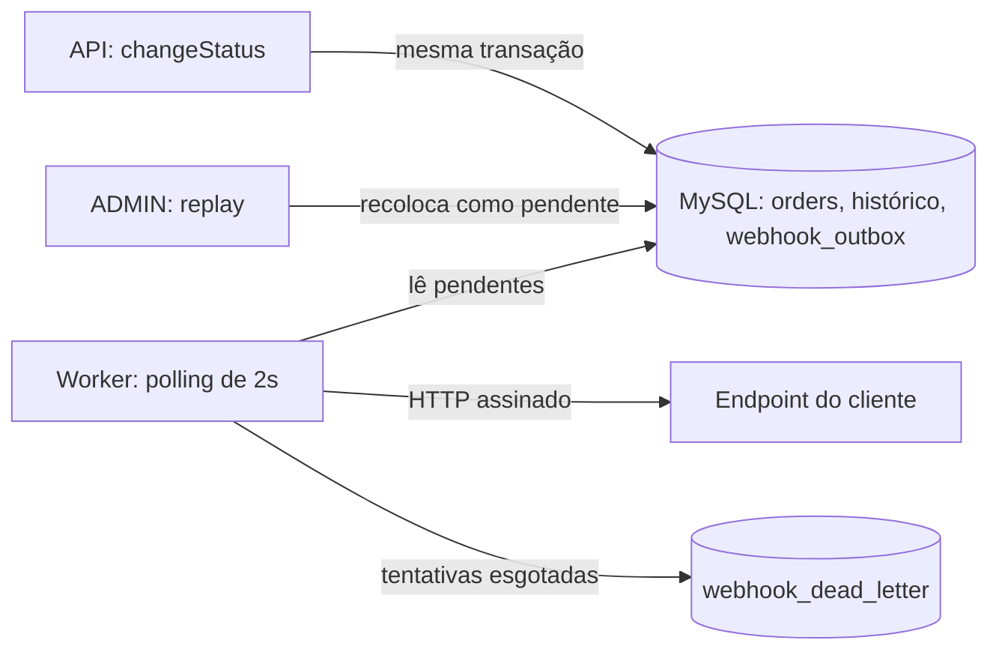

# RFC: Sistema de Webhooks de Notificação de Pedidos

## Metadados

| Campo | Valor |
| --- | --- |
| **Autor** | Diego Soares, autor deste pacote de documentos (não é o Diego participante da reunião) |
| **Status** | Em revisão |
| **Data** | 2026-11-02 |
| **Revisores** | Larissa (Tech Lead), Marcos (Product Manager), Bruno (Engenharia, Pedidos), Diego (Engenharia, Plataforma), Sofia (Segurança) |
| **Origem** | Reunião técnica de quinta-feira, 09:00; a transcrição não traz data de calendário |

## Resumo executivo (TL;DR)

Propomos notificar clientes B2B sobre mudanças de status de pedidos por webhooks de saída, sem HTTP dentro da transação de `changeStatus`. O evento é gravado em uma outbox no MySQL existente, na mesma transação da mudança de status. Um único worker, em processo separado, lê a outbox a cada 2 segundos e entrega por HTTP, com assinatura HMAC-SHA256, garantia at-least-once, 5 tentativas com backoff e DLQ com replay manual.

A proposta não adiciona infraestrutura. As decisões estão fechadas nos ADRs, e esta revisão se concentra nos pontos em aberto.

## Contexto e problema

**RFC-CTX-01:** Atlas Comercial, MaxDistribuição e Nova Cargo pediram formalmente para ser notificadas quando o status dos pedidos muda. Hoje elas consultam `GET /orders` periodicamente, o que deixa a integração "lenta e cara" ([09:00] Marcos).

**RFC-CTX-02:** para esses clientes, qualquer tempo abaixo de 10 segundos já é "tempo real" ([09:02] Marcos).

**RFC-CTX-03:** o fluxo é apenas de saída: os clientes querem receber, não enviar ([09:02] Marcos).

**RFC-CTX-04:** a aplicação não tem hoje mecanismo de evento, fila ou notificação externa. A mudança de status ocorre em uma transação de `src/modules/orders/order.service.ts`, que atualiza o pedido, grava o histórico e movimenta estoque nas transições aplicáveis. Essa transação não pode depender da disponibilidade de um cliente ([09:04] Bruno).

## Proposta técnica

**RFC-PROP-01, publicação:** `changeStatus` chama uma função que recebe o client da transação, aplica o filtro de status de cada webhook do customer e grava um snapshot do evento. Sem interessado, nada é gravado. Falha na gravação reverte a mudança de status ([ADR-001](adrs/ADR-001-outbox-no-mysql.md), [ADR-008](adrs/ADR-008-snapshot-e-filtro-na-insercao.md)).

**RFC-PROP-02, consumo:** um processo próprio (`src/worker.ts`, `npm run worker`), no mesmo banco e com a mesma stack, lê os pendentes mais antigos em batch pequeno ([ADR-002](adrs/ADR-002-worker-em-processo-separado-com-polling.md)). A ordem vale por pedido e enquanto houver um só worker ([ADR-003](adrs/ADR-003-worker-unico-e-ordenacao-por-pedido.md)).

**RFC-PROP-03, resiliência:** falhas e respostas que não chegam em 10 segundos seguem o backoff de 1m/5m/30m/2h/12h. Depois disso, o evento vai para uma tabela de DLQ, e só um ADMIN pode reprocessá-lo ([ADR-004](adrs/ADR-004-retry-com-backoff-e-dlq.md)).

**RFC-PROP-04, segurança e entrega:** cada endpoint tem secret própria e rotacionável, com 24 horas de validade paralela, e o corpo é assinado com HMAC-SHA256 ([ADR-005](adrs/ADR-005-hmac-sha256-com-secret-por-endpoint.md)). O cliente deduplica pelo `X-Event-Id` ([ADR-006](adrs/ADR-006-at-least-once-com-x-event-id.md)).

**RFC-PROP-05, gestão pela API:** um novo módulo oferece CRUD de configuração, rotação de secret e histórico de entregas, seguindo os padrões existentes ([ADR-007](adrs/ADR-007-reuso-dos-padroes-do-projeto.md)). Não há painel visual nesta fase ([09:40] Larissa).

Contratos, modelagem e fluxos detalhados estão no [FDD](FDD.md).

## Alternativas consideradas

| ID | Alternativa | Trade-off que motivou o descarte | Origem |
| --- | --- | --- | --- |
| **RFC-ALT-01** | HTTP síncrono em `changeStatus` | Dispensaria outbox e worker, mas um cliente lento travaria mudanças de status de outros pedidos, e um cliente fora do ar forçaria uma escolha sobre rollback | [09:04] Bruno |
| **RFC-ALT-02** | Redis Streams ou Cluster | Traria um mecanismo dedicado, mas exigiria subir mais infraestrutura para um time pequeno | [09:07] Larissa, [09:07] Diego |
| **RFC-ALT-03** | Trigger no MySQL para acionar o worker | Seria mais reativa do que o polling, mas a trigger não notifica processo externo e exigiria um aviso improvisado | [09:09] Bruno, [09:09] Diego |
| **RFC-ALT-04** | Garantia exactly-once | Livraria o cliente de deduplicar, mas exigiria coordenação dos dois lados e muito mais complexidade | [09:25] Diego |
| **RFC-ALT-05** | Retry indefinido | Nunca desistiria da entrega, mas deixaria eventos pendurados se o cliente sumisse | [09:15] Diego |

## Questões em aberto

**Citadas na reunião e adiadas ou não decididas**

| ID | Questão | Estado | Origem |
| --- | --- | --- | --- |
| **RFC-QA-01** | Rate limiting de saída para clientes com muitos eventos | Observar e decidir depois | [09:39] Larissa |
| **RFC-QA-02** | Aviso por e-mail quando o webhook do cliente estiver com problema | Adiado; talvez próxima fase, depois de medir o impacto | [09:37] Larissa |
| **RFC-QA-03** | Escala para vários workers, por particionamento ou lock pessimista | Adiado como "problema do futuro" | [09:13] Diego |
| **RFC-QA-04** | Endurecer as roles do CRUD de configuração | Possibilidade futura | [09:37] Sofia |
| **RFC-QA-06** | `customer_id` no body ou no path | Não fechado; os contratos do FDD usam as duas opções citadas (FDD-ND-16) | [09:32] Larissa |

**Não discutidas e aguardando os revisores**

| ID | Questão | Situação | Quem valida | Motivador |
| --- | --- | --- | --- | --- |
| **RFC-QA-08** | Um evento em retry segura os seguintes do mesmo pedido? | Escolha do autor: segura (FDD-AUT-01) | Larissa, Diego | [09:13] Larissa |
| **RFC-QA-09** | Como um evento atende a vários webhooks do customer? | Sem definição (FDD-ND-01) | Bruno, Diego | [09:44] Sofia |
| **RFC-QA-10** | Como assinar nas 24 horas em que as duas secrets valem? | Sem definição (FDD-ND-02) | Sofia | [09:21] Sofia |
| **RFC-QA-11** | Como a secret é armazenada em repouso? | Escolha do autor: texto na tabela (FDD-AUT-02) | Sofia | [09:21] Bruno |
| **RFC-QA-12** | Um usuário pode gerenciar webhooks de qualquer customer? | Sem definição (FDD-ND-22). A reunião só definiu que qualquer role autenticada usa o CRUD, e o código não tem vínculo entre usuário e customer | Sofia, Marcos | [09:37] Sofia |
| **RFC-QA-14** | Por quanto tempo o histórico de entregas fica guardado? | Sem definição (FDD-ND-14) | Bruno, Marcos | [09:34] Marcos |
| **RFC-QA-15** | Como um ADMIN encontra o `id` da DLQ para o replay? | Sem definição (FDD-ND-11) | Diego, Sofia | [09:18] Bruno |
| **RFC-QA-16** | Demais detalhes de implementação | Listados na seção 14 do [FDD](FDD.md), sem sugestão, para a sessão de revisão do design | Larissa, Bruno, Diego | [09:50] Larissa |

**Fechadas nesta revisão**

| ID | Questão | Resultado | Origem |
| --- | --- | --- | --- |
| **RFC-QA-07** | "5 tentativas" significa 5 reenvios depois do envio inicial? | Sim, como interpretação: só essa leitura fecha com "quase 15 horas entre primeira falha e última tentativa". O resumo final diz "total 5 tentativas" ([09:48] Larissa), então os revisores podem contestar | [09:17] Diego |
| **RFC-QA-13** | Quais métricas e sinais de rastreio usar? | Só o que os dados já definidos permitem, sem ferramenta nova, porque o enunciado exige o tema e a decisão foi de reuso máximo. Painéis e alertas seguem sem definição (FDD-ND-21) | [09:30] Larissa |

## Impacto e riscos

**Impacto**

- **RFC-IMP-01:** `changeStatus` é o ponto crítico da alteração; se a inserção falhar, a mudança de status é revertida ([09:40] Bruno).
- **RFC-IMP-02:** o sistema ganha um segundo processo, um novo módulo e novas tabelas, sem novo serviço de infraestrutura ([09:11] Diego, [09:27] Bruno).
- **RFC-IMP-03:** os clientes precisam verificar a assinatura e deduplicar eventos, o que será documentado no portal de desenvolvedor ([09:20] Sofia, [09:26] Marcos).
- **RFC-IMP-04:** a estimativa é de três sprints, com pelo menos dois dias úteis de revisão de segurança ([09:47] Larissa, [09:46] Sofia).

**Riscos arquiteturais**

Riscos de produto, como o de prazo, estão no [PRD](PRD.md), e os de implementação estão no [FDD](FDD.md).

| ID | Risco | Próximo passo | Origem |
| --- | --- | --- | --- |
| **RFC-RISK-02** | Worker único pode esperar até 10 segundos em cada cliente lento, atrasando os demais | Efeito não discutido na reunião; levar à revisão do design (FDD-RISK-01) | [09:42] Diego |
| **RFC-RISK-03** | A proteção de ADMIN no replay é limitada, porque `POST /auth/register` é público e aceita `role: ADMIN` | O comportamento já existe e está fora desta feature; levar à revisão de segurança | `src/modules/auth/auth.schemas.ts` |
| **RFC-RISK-04** | O JWT e o modelo `User` não têm vínculo com customer, então o código não limita qual customer um usuário gerencia | Sem definição em RFC-QA-12; endurecer as roles é possibilidade futura (RFC-QA-04) | `src/middlewares/auth.middleware.ts` |
| **RFC-RISK-05** | Falha na outbox passa a impedir a mudança de status | Comportamento decidido na reunião | [09:40] Bruno |

## Decisões relacionadas

- [ADR-001: Padrão Outbox no MySQL existente](adrs/ADR-001-outbox-no-mysql.md)
- [ADR-002: Worker em processo separado com polling de 2 segundos](adrs/ADR-002-worker-em-processo-separado-com-polling.md)
- [ADR-003: Worker único e ordenação apenas por pedido](adrs/ADR-003-worker-unico-e-ordenacao-por-pedido.md)
- [ADR-004: Retry com backoff exponencial e DLQ em tabela separada](adrs/ADR-004-retry-com-backoff-e-dlq.md)
- [ADR-005: HMAC-SHA256 com secret por endpoint](adrs/ADR-005-hmac-sha256-com-secret-por-endpoint.md)
- [ADR-006: Entrega at-least-once com `X-Event-Id`](adrs/ADR-006-at-least-once-com-x-event-id.md)
- [ADR-007: Reuso dos padrões existentes do projeto](adrs/ADR-007-reuso-dos-padroes-do-projeto.md)
- [ADR-008: Filtro e snapshot do payload na inserção](adrs/ADR-008-snapshot-e-filtro-na-insercao.md)

## Changelog

Detalhes e IDs afetados na seção Changelog de [TRACKER.md](TRACKER.md).

| CHG | Resumo |
| --- | --- |
| CHG-000 | Versão inicial, linha de base do pacote |
| CHG-018 | Questões reorganizadas em adiadas, aguardando revisores e fechadas |
| CHG-019 | Arquivamento retirado das questões, por estar fora do escopo da feature |
| CHG-020 | Riscos limitados aos arquiteturais; prazo remetido ao PRD |
| CHG-036 | Limite de customer por usuário reaberto; "5 tentativas" registra o resumo final da reunião |
| CHG-043 | Link para o tracker com rótulo relativo a este arquivo e sem âncora |
